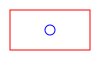

# Desk Lamp

A small lamp for the corner of a desk: a printed base, a laser-cut mounting plate and a driver
board.

- The printed part is [base.stl](models/base.stl), a 20 mm box standing in for the real base.
- The board's Gerber set and its schematic are in `pcb/`.

