# System audit & architecture reference — 2026-07-28

**Subject:** Maker Server (`tinkerex`) — Rails 8 sync server + Rust local-first client + maker web layer
**Commit audited:** `6ca3dd7` (merge of PR #91)
**Method:** every claim below was *executed or read*, not inferred. Reproduction commands are in [§8](#8-appendix--how-every-claim-here-was-verified).

---

## 1. Verdict

The system is in **good structural health and poor supply-chain hygiene**. The architecture is
unusually well-defended — the boundaries are real, enforced by tests, and documented with the
reasoning rather than just the rule. The problems are all on the maintenance edge: dependencies have
drifted behind published advisories, and the CI job that exists to catch exactly that is currently
failing.

| Dimension | Verdict | Note |
|---|---|---|
| Test health | 🟢 Strong | 1587 server tests green; 306 Rust tests green across 7 crates |
| Architecture / boundaries | 🟢 Strong | All 3 documented tripwires hold; port abstraction is honest about itself |
| Licensing (§9 permissive) | 🟢 Good, 1 gap | GPL isolation enforced by a test; one GPL image ships without its licence text |
| **Dependency security** | 🔴 **Action needed** | 5 gems behind advisories, 1 rated **High**, in the always-on `/cable` path |
| **CI signal** | 🔴 **Action needed** | `scan_ruby` fails at step 1; `bundler-audit` never runs behind it |
| Auth surface | 🟠 One real hole | Unauthenticated Active Storage direct-upload route is live |
| Input validation | 🟠 One gap | `maker_sheets.data` is unbounded user-controlled JSON |
| Docs accuracy | 🟢 Good | `STATUS.md` is current and self-critical; `CLAUDE.md` has one stale count |

The single most valuable thing to do is **unblock CI's security job** — everything under
[§2.1](#21--red--five-gems-behind-published-advisories-one-high) and
[§2.2](#22--red--the-scan_ruby-ci-job-fails-before-it-reaches-bundler-audit) is one afternoon of
work, and until it is done the repo has no working early-warning system for the next advisory.

---

## 2. Audit findings

Ranked by what I would fix first. Each carries the evidence that produced it.

### 2.1 🔴 RED — Five gems behind published advisories, one High

`bundle exec bundler-audit check --update` reports **7 advisories across 5 gems**:

| Gem | Installed | Severity | Fix | Exposure in *this* app |
|---|---|---|---|---|
| **websocket-driver** | 0.8.1 | **High** — CVE-2026-61666 | `>= 0.8.2` | **Directly reachable.** It is `actioncable`'s own dependency (`Gemfile.lock:10`), and `/cable` is mounted and connected to by **every device, continuously** — it is the sync nudge channel. A DoS via malformed `Host` header hits the always-on socket. |
| loofah | 2.25.1 | Medium + 2 | `>= 2.25.2` | Action Text sanitization — the path that renders user-authored project notes and build-log entries (`javascript:` URI bypasses). |
| rails-html-sanitizer | 1.7.0 | Unknown (XSS) | `>= 1.7.1` | Same Action Text path. |
| nokogiri | 1.19.3 | Low + 8 | `>= 1.19.4` | Parses **untrusted user file content** — `Maker::Previews::Lbrn2` reads uploaded `.lbrn2`/`.lbrn` XML. Several advisories are use-after-free in exactly that surface. |
| crass | 1.0.6 | Unknown ×4 | `>= 1.0.7` | Transitive via loofah; CSS parser DoS. |

Every one is a **transitive or loosely-pinned** upgrade — `Gemfile` says `nokogiri "~> 1.18"`, which
already permits 1.19.4, and the other four are not named in the `Gemfile` at all. So the fix is a
lockfile bump, not a constraint change:

```bash
bundle update nokogiri loofah rails-html-sanitizer crass websocket-driver
```

The nokogiri and loofah pair matters most beyond the CVSS number: nokogiri parses **file bytes a
user uploaded**, and loofah sanitizes **rich text a user typed**. Both are attacker-shaped inputs in
the normal product flow, not edge cases.

### 2.2 🔴 RED — The `scan_ruby` CI job fails before it reaches bundler-audit

`.github/workflows/ci.yml` runs two security steps in order:

```yaml
- run: bin/brakeman --no-pager     # step 1
- run: bin/bundler-audit           # step 2
```

Measured exit codes on this commit:

| Command | Exit | Meaning |
|---|---|---|
| `bin/brakeman --no-pager` | **3** | warnings found — non-zero, so the job stops here |
| `bin/bundler-audit` | **1** | vulnerabilities found — **never runs**, because step 1 already failed |

So the job is red, *and* the gem advisories in §2.1 have no chance of surfacing even once brakeman is
fixed. This is worse than a plain failure: the pipeline looks like it has two gates and currently
has zero.

**The brakeman warning that blocks it is a false positive**, and identical in kind to one already
accepted:

```
Command Injection — app/services/maker/previews/image_thumb.rb:45
Open3.capture3(BIN, path, "--size", "#{size}x#{size}", "-o", out_path)
```

`Open3.capture3` with an **argv array** execs the binary directly — no shell, so no shell injection.
`BIN` is operator-controlled (`ENV["VIPSTHUMBNAIL_BIN"]`), both paths are `Tempfile`-generated, and
`size` is an integer preview dimension in its own argv element. `config/brakeman.ignore` already
carries a fully-reasoned entry for **`maker/previews/mesh.rb`** — the same `Open3.capture3(*args)`
pattern, the same argument, written out at length. `image_thumb.rb` was added later and the ignore
entry was never extended to match.

**Fix:** add `image_thumb.rb:45` to `config/brakeman.ignore` with the same note the `mesh.rb` entry
carries, then land §2.1 so step 2 goes green too. Verify both by exit code, not by reading output:

```bash
bin/brakeman --no-pager; echo "brakeman=$?"; bin/bundler-audit; echo "audit=$?"
```

> `bin/importmap audit` (the JS half, a separate job) is **green** — no vulnerable browser packages.

### 2.3 🟠 ORANGE — Unauthenticated Active Storage direct-upload route is live

Already identified in `docs/STATUS.md` as open item #1; I re-verified it independently because it is
the highest-severity item in the app's own backlog.

```
$ bin/rails routes | grep direct_upload
rails_direct_uploads POST /rails/active_storage/direct_uploads  active_storage/direct_uploads#create
```

`ActiveStorage::DirectUploadsController` descends from `ActiveStorage::BaseController`, **not** this
app's `ApplicationController` — so it inherits none of the app's auth. And `ApplicationController`
itself declares no global `before_action :authenticate_user!`; auth is applied per-controller. That
is fine for the app's own controllers (I checked all of them — see below) but it means an
engine-mounted controller silently opts out.

The consequence is an **unauthenticated storage-write primitive**: anyone who can reach the host can
mint an `ActiveStorage::Blob` row and receive a signed upload URL. There is no read-back without a
signed id, so this is a resource-consumption and storage-cost issue rather than data disclosure —
but it is uncapped, and in the managed/SaaS mode (§7) the cost lands on the operator.

Auth coverage across the app's own web controllers is otherwise **complete**. The six that do not
declare `authenticate_user!` directly all resolve correctly:

| Controller | Why it is fine |
|---|---|
| `ApplicationController` | base class; no routable actions |
| `Tools::{Home,Boxes,Generators,Openscad}Controller` | inherit `Tools::BaseController`, which declares `before_action :authenticate_user!` |
| `DevBlobsController` | dev/test only — `before_action :ensure_memory_store`, and the route is not mounted in production |

**Fix options** (costed in the design spec's §9a): strip `<action-text-attachment>` server-side on
`Note`/`BuildLogEntry` bodies, gate the route with a constraint, or both. The client half is already
solid — Lexxy is configured `attachments="false"` and never registers the drop listeners — so this
is closing the server half of a restriction that already exists in the UI.

### 2.4 🟠 ORANGE — `maker_sheets.data` accepts unbounded user JSON

Confirmed by reading both ends:

- `app/models/maker/sheet.rb` — the only validation is `validates :name, presence: true`.
- `app/controllers/projects/sheets_controller.rb:61` — `params.require(:sheet).permit(:name, :position, data: {})`, permitted whole and unbounded.

The blob is then embedded into the page HTML on every view with no truncation, so growth is paid for
twice: once in the row, once in every render. A buggy autosave loop or a genuinely large sheet grows
this without a ceiling. A byte-length validation on `data` plus a render-time guard is the small fix.

### 2.5 🟡 YELLOW — `sidecar/boxes` ships a GPL-3.0 image without its licence text

The §9 licensing posture is otherwise **enforced, not merely documented** —
`test/deploy_hygiene_test.rb` asserts `/sidecar/` is in `.dockerignore` (so `COPY . .` cannot bake
the copyleft trees into the permissive app image) and asserts the OVH overlay explicitly blanks every
`*_SIDECAR_URL`. Both were real shipped bugs; both are now guarded by a test that can see files the
Rails process never loads. That is the right shape.

The gap is redistribution obligation, and the two sidecars **disagree with each other**:

| Sidecar | Licence | `LICENSE` in repo | `COPY`'d into the image |
|---|---|---|---|
| `sidecar/openscad` | GPL-2.0 | ✅ | ✅ `COPY LICENSE README.md ./` + `catalog/NOTICE` |
| `sidecar/boxes` | GPL-3.0 | ✅ | ❌ **never copied** — the Dockerfile copies only `requirements.txt` and `app.py` |

A GPL image we build and push to a registry is redistribution; the licence text belongs inside it.
One line in `sidecar/boxes/Dockerfile` closes it. `CLAUDE.md` already flags this as "worth closing
when boxes is next touched" — it is still open, and it is a two-minute fix, so it is worth doing now
rather than waiting for a reason to touch that file.

### 2.6 🟡 YELLOW — STEP / IGES / OBJ previews are wired but cannot run on the deployed image

`Maker::Previews::Registry` maps `step`, `stp`, `iges`, `igs` and `obj` to `Maker::Previews::Mesh`,
which shells out to the **F3D** CLI. The `Dockerfile` installs `libvips-tools`, and builds
`stl-thumbnailer`, `resvg` and `pdfium` in dedicated stages — but **no `f3d` binary is installed
anywhere in it**.

This degrades correctly rather than failing: `Mesh.available?` gates on the binary, so those
extensions fall through to `unsupported` — the same graceful path the design intends. But the
practical effect is that the CAD formats most specific to this product's audience have **no preview
on the shipped server**, while the code reads as though they do. Either add an f3d stage to the
Dockerfile or note the gap next to the registry entries so the next reader is not misled.

### 2.7 🟢 GREEN — All three documented architectural tripwires hold

`CLAUDE.md` names three greps as executable proofs of its boundaries. I ran all three:

| Tripwire | Expected | Actual | ✓ |
|---|---|---|---|
| Maker layer never references chunks | exactly 1 hit, `library_output.rb` | exactly 1: `library_output.rb:47` | ✅ |
| No `rescue NotImplementedError` anywhere | nothing | nothing | ✅ |
| `port_writable?` branch sites | 5 named sites | 5 branch sites + 3 UI-selection sites + registry/docs | ✅ |

The third deserves a note, because the count is easy to misread. The five *doors to the bytes* are
`Maker::LibraryFolder#mkdir`, `FilesController#destroy`, `TrashController#restore`,
`Maker::Addons::LibraryOutput.write`, and `Maker::MoveNode`. The extra `port_writable?` reads in
views and `ModelsController` select a **UI form**, which is the capability's stated job and not a
fourth door. The documented rule — *a new inline copy needs an argument for being inline rather than
a service* — is intact.

### 2.8 🟢 GREEN — Test health

| Suite | Result |
|---|---|
| Rails server (`bin/rails test`) | **1587 runs, 5482 assertions, 0 failures, 0 errors, 14 skips** — 5.2 s across 10 parallel workers |
| `fs-provider` (20 binaries) | **192 passed, 0 failed** |
| `sync-engine` (lib) | 13 passed, 0 failed |
| `sync-client` | 35 passed, 0 failed |
| `fs-cfapi` | 42 passed, 0 failed |
| `fs-fskit` | 13 passed, 0 failed |
| `stl-thumbnailer` | 7 passed, 0 failed |
| `fs-webdav` | 4 passed, 0 failed |
| `fs-fuse` | **cannot build on this macOS host** — `fuser` needs a `fuse.pc` pkg-config alias. Expected and documented; Linux-only crate. |
| `fs-winfsp` | 0 tests (Windows-only FFI shim) |

**Doc drift, minor:** `CLAUDE.md` §11 states `fs-provider` has "**53 tests**". It has **192** across
20 binaries. `CLAUDE.md` defers per-suite counts to `docs/STATUS.md` elsewhere, so the cleanest fix
is to delete the number rather than chase it.

The known weakness is honestly recorded in `STATUS.md` #3 and worth repeating here because it
explains a *shape* of bug the green suite cannot see: **nothing in the test suite executes
JavaScript.** `test/system/` and `ApplicationSystemTestCase` exist, but every test added by the most
recent arc is server-side. Two real spreadsheet-grid bugs shipped past 1587 green tests on three
backends for exactly that reason. The browser-side surface is now substantial — Three.js viewer,
JSZip importer, Maker.js generators, the jspreadsheet grid — and it is untested.

---

## 3. Architecture — C4 model

> Levels 1–3 of the C4 model, drawn as Mermaid flowcharts rather than Mermaid's experimental `C4*`
> dialect: the semantics are C4 (person / system / container / component, each labelled with its
> technology and responsibility), the renderer is the one that lays out reliably.

### 3.1 Level 1 — System context

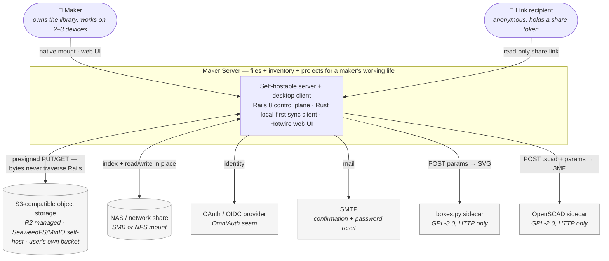

**The two deliberate boundaries in this picture:**

1. **Bytes bypass the control plane.** Rails mints presigned URLs; the client and browser move chunk
   bytes straight to and from object storage. This is invariant §15 and it is why the managed mode's
   egress cost is storage-priced, not app-server-priced.
2. **Copyleft is reached only over HTTP.** `boxes.py` (GPL-3.0) and OpenSCAD (GPL-2.0) run as
   separate images and are *invoked*, never linked or bundled — the permissive-licensing constraint
   (§9) made process isolation the design, not an optimisation.

### 3.2 Level 2 — Containers

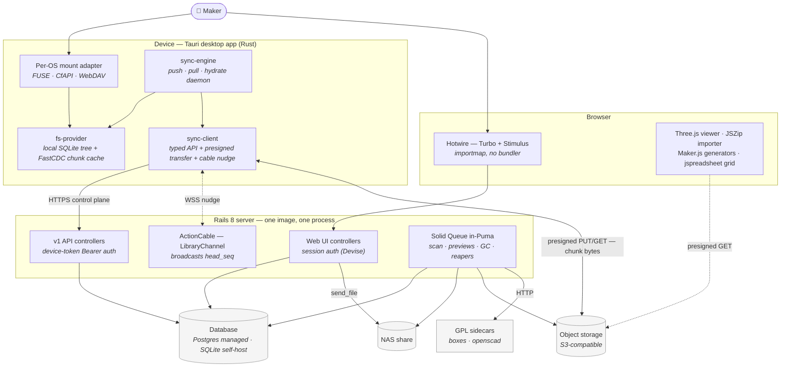

**Three channels, deliberately separated** (`docs/sync-protocol.md`): HTTPS for control, WebSocket
for the *nudge only* (a bare `{head_seq}`, never data), and direct-to-storage for bytes. The nudge is
the fast path (~39 ms measured) and the cursor-delta poll is the correctness fallback — the same
belt-and-braces every production sync client uses.

### 3.3 Level 3 — Components inside the Rails server

```mermaid
flowchart TB
    subgraph ctl ["Controllers — three auth realms, never mixed"]
        cweb["Web UI · session<br/>Files · Projects · Models · Trash · Tools"]
        cv1["v1 API · device token<br/>commits · changes · tree · nodes · maker"]
        cshare["Share redeem · anonymous<br/><i>the token IS the auth</i>"]
    end

    subgraph gate ["Capability gating"]
        caps["FileLayer::Capabilities<br/><i>versioned · syncable · presignable<br/>scannable · port_writable</i>"]
        lc["LibraryCapabilities concern<br/><i>501 BEFORE the call, never a rescue</i>"]
    end

    subgraph sync ["Sync:: — the chunk data plane"]
        commit["Commit<br/><i>two-phase, base_version_id</i>"]
        mut["Mutation · SubtreeDelete · Restore"]
        changes["Changes · Tree · Search"]
        conf["Conflicts · Locks · Trash"]
        gc["Gc · RetentionPolicy<br/>ChunkReaper · PendingCommitReaper"]
    end

    subgraph port ["FileLayer port — one seam, three adapters"]
        chunk["Chunk<br/><i>versioned ✓ syncable ✓<br/>presignable ✓ port_writable ✗</i>"]
        share["Share<br/><i>mounted dir; current-state only</i>"]
        s3a["S3<br/><i>user's bucket; presignable ✓ versioned ✗</i>"]
    end

    subgraph lib ["Library:: — catalog reconciliation (share + s3 only)"]
        scan["Scanner<br/><i>hand-rolled walk; EACCES-safe</i>"]
        obs["S3Observer<br/><i>complete-or-abort listing</i>"]
        rec["Reconciler<br/><i>path-match → move-pair → revive → create</i>"]
    end

    subgraph mk ["Maker:: — the product layer"]
        mmod["Models: Project · Item · BOM · Inventory<br/>Task · Sheet · Model · PrintRun · Tag"]
        mops["MoveNode · AttachToProject · LibraryFolder · FileBytes"]
        prev["Previews::Registry → 20 extensions"]
        add["Addons::Registry → boxes · generators · openscad"]
    end

    st["Storage::ChunkStore<br/><i>S3 · Local · Memory</i>"]
    del["FileLayer::Delivery<br/><i>Redirect · SendFile · Stream</i>"]

    cweb --> lc
    cv1 --> lc
    lc --> caps
    cweb --> mops
    cweb --> chunk
    cweb --> share
    cweb --> s3a
    cv1 --> commit
    cv1 --> changes
    cshare --> st
    commit --> st
    chunk --> st
    chunk --> del
    share --> del
    s3a --> del
    scan --> rec
    obs --> rec
    rec --> share
    rec --> s3a
    mops --> chunk
    prev --> chunk
    add --> chunk
```

**The load-bearing idea in this diagram is the port.** `FileLayer` is the seam between the maker
product and whatever holds the bytes, selected once per deployment by `LIBRARY_BACKEND`. Its five
read/write verbs (`stat`, `stat_all`, `read`, `download`, `trashed` — plus `write`, `delete`, `move`,
`undelete` where supported) are pinned by two shared contracts that every adapter runs in the default
suite, which is what stops the three backends drifting apart.

`Capabilities` is what makes it honest. Rather than the UI guessing what the deployment can do, each
adapter *declares* it, and Phase 4 pins every capability to what the adapter actually does — so a
hand-written `Data` literal cannot lie about its own backend. The subtlety that keeps biting readers:
`port_writable` means *which upload flow the UI drives*, not *whether uploads work at all*. Chunk
mode has `port_writable: false` and accepts uploads all day, through `Sync::Commit`.

### 3.4 Level 3 — Components inside the client

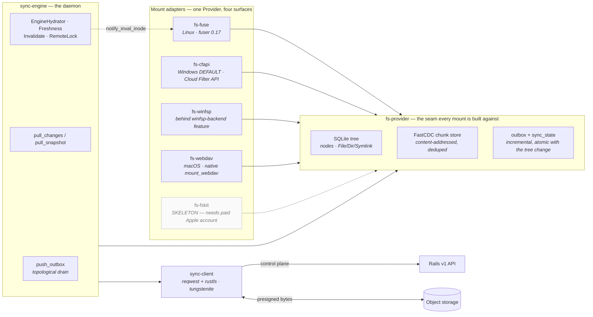

Every mount speaks to the same `Provider` trait. That is why a bug fixed in the tree is fixed on all
three OSes at once, and why the Windows migration from WinFsp to CfAPI was a swap of one adapter
rather than a rewrite — which also removed the last GPL driver from the Windows story.

---

## 4. Flow diagrams

### 4.1 Push — a local write reaches the server

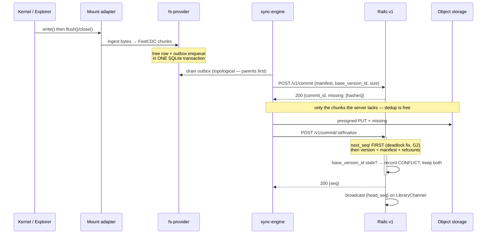

Two decisions in here were bought with real bugs. **`next_seq!` runs first** inside finalize, because
otherwise two concurrent commits deadlock upgrading `FOR KEY SHARE` → `FOR UPDATE` on Postgres. And
**the outbox drains topologically**, because a child pushed before its parent produces a changelog
the receiving device cannot apply — found by the adversarial fault harness, not by review.

### 4.2 Pull, nudge, and hydrate

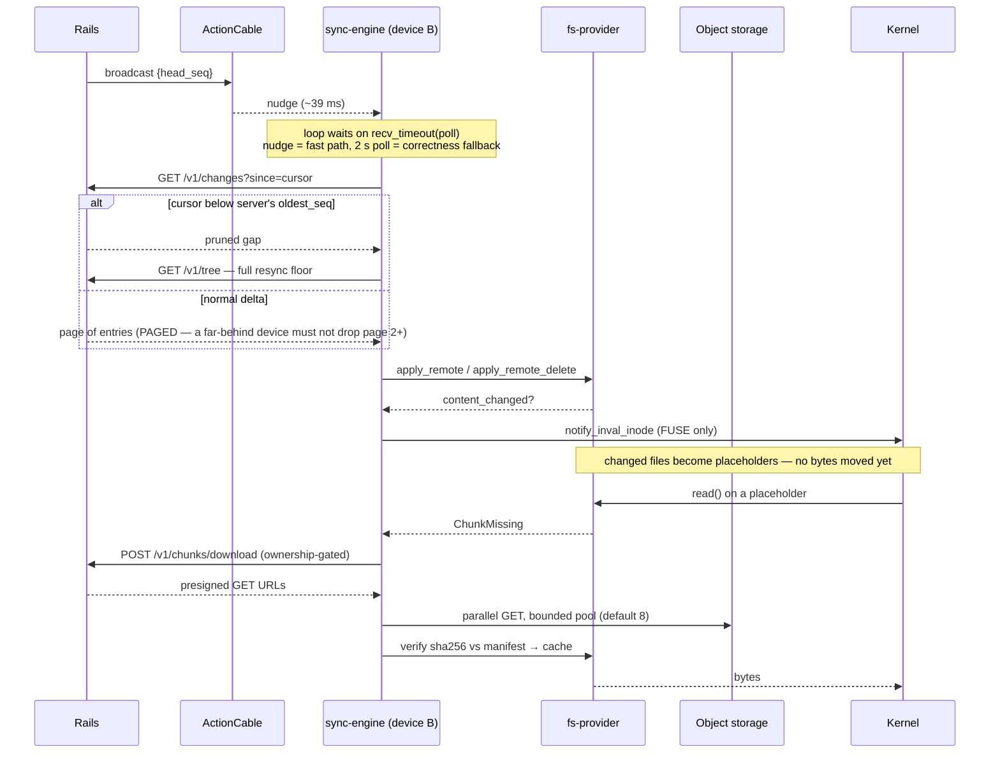

The **sha256 verification before caching** is the quiet detail that matters: corrupt or truncated
bytes from storage are rejected rather than cached and served as file content.

### 4.3 Web upload — two doors, one per deployment

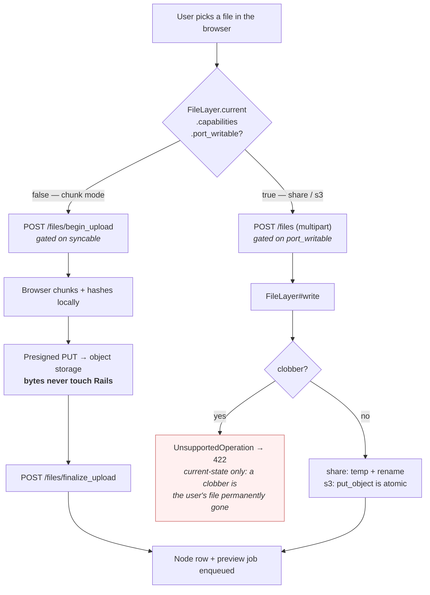

The wrong door for a deployment answers **501, decided before the call** — never a
`rescue NotImplementedError`, because `NotImplementedError` is a `ScriptError` and `rescue => e`
does not catch it. A rescue-based gate here does not have a gap; it silently does not work.

### 4.4 Scan and reconcile — share and S3 libraries

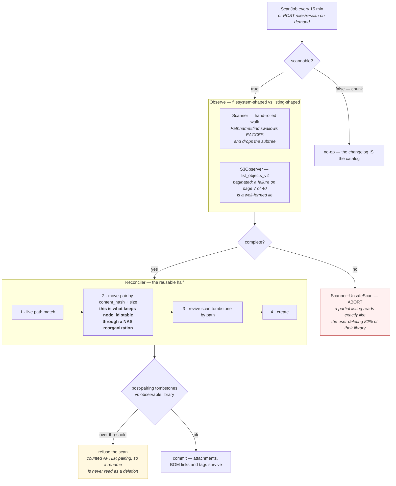

**Two tombstone kinds, and collapsing them is the trap.** A *scan* tombstone keeps `storage_path` and
is revivable by path. A *trash* tombstone NULLs it and is revivable only by `undelete`. Merge them and
the reconciler hands a new, unrelated file the trashed node's `node_id` — and with it every project
attachment, BOM link and tag — while the old bytes sit in `.trash` awaiting an `undelete` that then
collides. Silently.

The other recurring hazard is the **skip-list blind spot**: any path that writes into `.trash` or
`.maker-tmp-*` while leaving a live node pointing at the old path creates a ghost the reconciler can
never pair, which trips the mass-deletion guard and wedges every subsequent scan permanently. Four
instances have been found, each after the previous explanation said it could not happen. The working
rule is *assume every path that writes is exposed until you have checked it.*

### 4.5 Preview pipeline

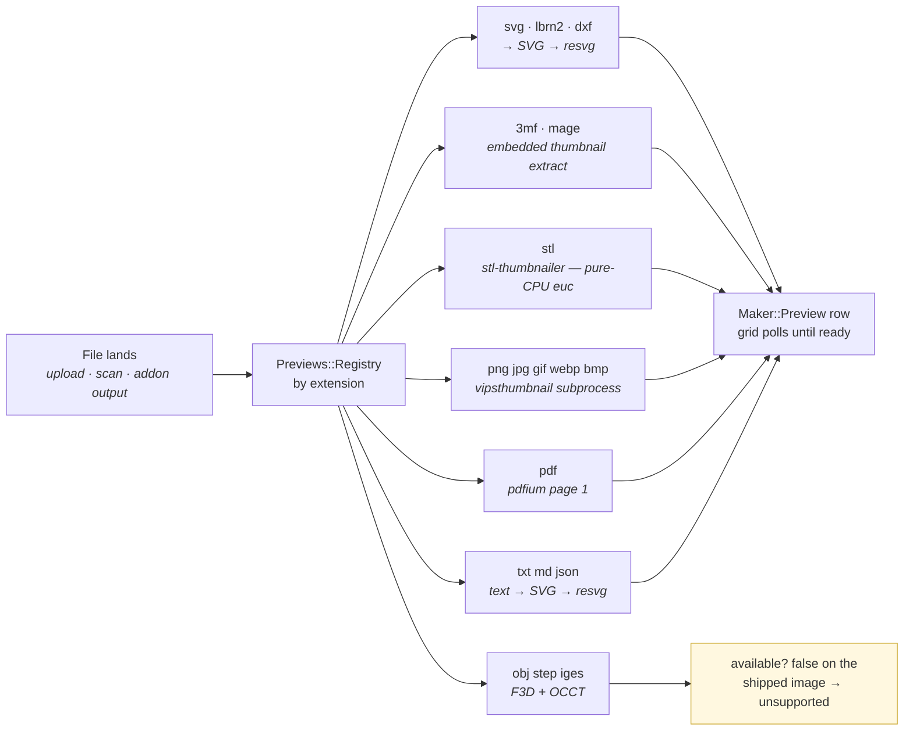

Every renderer is a **subprocess, never an in-process FFI binding** — and that is not stylistic.
in-process libvips spins up a thread pool, and Rails' fork-based parallel test runner deadlocks on it
(`VIPS_CONCURRENCY=1` does not fix it). Subprocesses also keep the LGPL OpenCASCADE dependency out of
the shipped binary, which is the same §9 posture as the sidecars one level up. See
[§2.6](#26--yellow--step--iges--obj-previews-are-wired-but-cannot-run-on-the-deployed-image) for the
`g` branch.

### 4.6 Addon (GPL sidecar) round trip

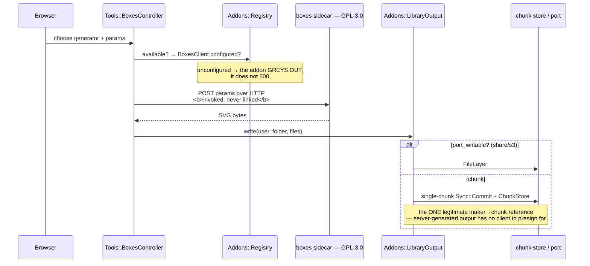

---

## 5. Technology inventory — what, and why it is right *here*

The constraints every choice below answers: **permissive licences only** (§9 — this is a commercial
product), **self-host and managed from one codebase** (§7), **bytes out of Rails** (§15), and
**local-first metadata** (§2).

### 5.1 Server — Ruby

| Library | Version | Licence | Why this one |
|---|---|---|---|
| **Rails** | 8.1.3 | MIT | The whole product is one deployable — control plane, web UI, jobs, and WebSocket in a single process. Rails 8's Solid trio removed the Redis/Sidekiq dependency that would otherwise make "self-host on an Unraid box" a multi-service install. |
| **Ruby** | 3.4.7 | Ruby/BSD | — |
| **SQLite3** | 2.9.5 | Public domain | Self-host default. Zero-administration, single file, and the same models run on it — which is what makes the self-host story a config change rather than a fork. |
| **pg** | 1.6.3 | BSD-2 | Managed default. Both adapters ship; `DATABASE_URL` picks. No PG-only SQL in the hot path, so `next_seq!`'s row lock is correct on both. |
| **Puma** | 8.0.2 | BSD-3 | Threaded, and hosts Solid Queue in-process via `SOLID_QUEUE_IN_PUMA` — one container instead of two. |
| **Solid Queue / Cache / Cable** | 1.4.0 / 1.0.10 / 4.0.0 | MIT | Database-backed, so a self-hoster installs **no Redis**. Cable in particular matters: the `{head_seq}` nudge is the difference between 39 ms and a 2 s poll, and it costs no new service. |
| **Devise** | 5.0.4 | MIT | Human web identity — confirmations, resets, lockable. Governs *only* the web layer; the v1 device-token machinery is untouched underneath, which keeps the two auth realms genuinely separate. |
| **OmniAuth** + `omniauth_openid_connect` | 2.1.4 / 0.8.0 | MIT | Keeps the OAuth/OIDC seam open without committing to a provider. `omniauth-rails_csrf_protection` is non-optional — the request-phase CSRF hole is a real account-takeover vector, and one was found and fixed here. |
| **bcrypt** | 3.1.22 | MIT | Standard adaptive hash behind `has_secure_password`. |
| **aws-sdk-s3** | 1.226.0 | Apache-2.0 | Pure-Ruby SigV4 presigning, so URLs can be minted and verified **without the storage being reachable** — you can test the presign path offline. Works unchanged against R2, SeaweedFS, MinIO and AWS. |
| **Hotwire** — turbo-rails 2.0.23 + stimulus-rails 1.3.4 | MIT | Server-rendered HTML over the wire. For a self-hosted app this removes an entire build toolchain from the deploy story. |
| **importmap-rails** | 2.2.3 | MIT | **No Node, no bundler, no `node_modules` in the image.** ESM is vendored and served by Propshaft. The cost is real and documented — jspm shared chunks need hand-patching — but it is paid once, not on every deploy. |
| **Propshaft** | 1.3.2 | MIT | Digest-and-serve, nothing more. Sprockets' transformation pipeline buys nothing when assets are pre-built. |
| **Nokogiri** | 1.19.3 ⚠️ | MIT | Parses LightBurn `.lbrn2` XML → SVG. Mature and fast. **See [§2.1](#21--red--five-gems-behind-published-advisories-one-high)** — it parses untrusted uploads and is behind 9 advisories. |
| **rubyzip** | 3.4.0 | BSD-2 | Extracts the embedded thumbnail from a 3MF (an OPC/zip container) without unpacking the whole model. |
| **Lexxy** | 0.9.27 (exact) | MIT | Basecamp's Action Text editor, replacing Trix. **Pinned exactly, not `~>`** — it shed its beta suffix in June 2026 and shipped six releases in 24 days; patch-level looseness is not safe on a pre-1.0 line moving that fast. Used text-only: attachments run through Active Storage, a store the FileLayer port exists to avoid. |
| **kramdown** | 2.5.2 | MIT | Markdown rendering, pure Ruby. |
| **image_processing** | 2.0.2 | MIT | Active Storage variants. |
| **csv** | 3.3.6 | Ruby/BSD | Needed explicitly since Ruby 3.4 made it a bundled rather than default gem — `require "csv"` raises `LoadError` under `Bundler.setup` without the Gemfile line. |
| **Kamal** | 2.11.0 | MIT | Deploys the same image to a home Unraid box and a cloud VM with no orchestration layer. Three `LIBRARY_BACKEND` variants coexist on one host via destination overlays — which is how all three backends are exercised live. |
| **Thruster** | 0.1.21 | MIT | HTTP caching/compression in front of Puma without adding nginx. |
| **Brakeman / bundler-audit / rubocop-rails-omakase** | 8.0.5 / 0.9.3 / 1.1.0 | MIT | The security and style gates. Correctly chosen; **currently not passing** — [§2.2](#22--red--the-scan_ruby-ci-job-fails-before-it-reaches-bundler-audit). |
| **Capybara / selenium-webdriver** | 3.40.0 / 4.45.0 | MIT / Apache-2.0 | Present and wired — but **no test currently drives JS** ([§2.8](#28--green--test-health)). |

### 5.2 Client — Rust

| Crate | Version | Licence | Why this one |
|---|---|---|---|
| **fastcdc** | 3.x | MIT | Content-defined chunking is the whole capability: block-level delta sync *and* dedup *and* cheap versioning fall out of it. The permissive alternatives were weighed (desync BSD-3, restic/chunker BSD-2); FastCDC is the fastest published algorithm with a maintained MIT Rust implementation, and §9 rules out the copyleft options outright. |
| **rusqlite** (`bundled`) | 0.32 | MIT | The local tree. `bundled` compiles SQLite in — no system dependency on any of three OSes. This is what makes `stat`/`readdir` instant and keeps the WAN out of the metadata path. |
| **sha2 + hex** | 0.10 / 0.4 | MIT/Apache-2.0 | Content addressing, and hydrate-time integrity verification against the manifest hash. Must be the *same* hash on both paths — it is. |
| **fuser** | 0.17 | MIT | Linux FUSE. 0.17 specifically: the abi-7-xx feature gates are gone, so `Notifier::inval_inode` — active cache invalidation on a content-changing pull — is always available. The 0.14→0.17 upgrade also surfaced a real bug: `run_until_unmounted` must `join()`, not `umount_and_join()`, which self-unmounts in 0.17. |
| **windows** + **widestring** | 0.61 / 1.x | MIT/Apache-2.0 | Windows FFI. The `Win32_Storage_CloudFilters` feature is the CfAPI surface. |
| *(CfAPI itself)* | — | *OS component* | **`cldapi.dll` is part of Windows.** No driver, no SDK install, **no GPL** — this is precisely why CfAPI replaced WinFsp (GPL) as the default Windows backend, and it also gives the native OneDrive placeholder UX in Explorer for free. |
| **winfsp** | 0.13 | Apache-2.0 *(driver is GPL)* | Retained one release behind the `winfsp-backend` cargo feature. The **driver** is user-installed and never bundled, so no copyleft reaches our binaries either way. |
| **dav-server** | 0.11 | MIT/Apache-2.0 | The macOS mount path. macOS gets **WebDAV via native `mount_webdav`** because FUSE-T's FSKit build cannot mount on macOS 26 (silent failure, greyed-out extension toggle) and macFUSE is a kext. WebDAV needs no kext, no driver, and no paid Apple Developer membership — the only zero-install option left. |
| **tokio / hyper / hyper-util** | 1.x / 1.x / 0.1 | MIT | Async runtime and HTTP server behind the WebDAV adapter. |
| **reqwest** (`rustls-tls`, no default features) | 0.12 | MIT/Apache-2.0 | HTTPS to the control plane. **rustls, not OpenSSL** — no system TLS library to build or ship on three OSes. |
| **tungstenite** (`rustls-tls-webpki-roots`) | 0.24 | MIT/Apache-2.0 | Blocking WebSocket for the ActionCable nudge. `webpki-roots` so `wss://` works without the system trust store. |
| **serde / serde_json / base64 / thiserror / uuid / libc / bytes** | — | MIT/Apache-2.0 | Standard plumbing. `base64` specifically carries symlink targets — raw, possibly non-UTF-8 path bytes — losslessly over JSON. |
| **euc** | 0.5.3 (pinned) | Apache-2.0/MIT | **Pure-CPU software rasterizer for STL thumbnails — no GPU, no OpenGL, no Mesa, no X11.** That is the requirement: the renderer runs inside a headless Rails container. Pinned to 0.5.3 because master/0.6.0 produced empty frames on this commit. |
| **vek** | 0.14 (pinned) | MIT | Pinned to *match* euc 0.5.3's own vek so `Vec3<f32>` satisfies euc's `Interpolate` bound. |
| **stl_io / image** | 0.8 / 0.25 | MIT / MIT-or-Apache | Binary + ASCII STL parsing; PNG encoding. |
| **proptest** *(dev)* | 1.x | MIT/Apache-2.0 | Property-based chunking and convergence tests, with shrinking to minimal reproducers. Dev-only, so nothing ships. |
| **Tauri** | 2.x | MIT/Apache-2.0 | Desktop shell. Uses the OS webview instead of bundling Chromium — a ~10 MB binary rather than ~100 MB, and the sync core is already Rust, so the app is a thin command layer over it. |

### 5.3 Browser

| Library | Version | Licence | Why this one |
|---|---|---|---|
| **Three.js** | r0.185.1 | MIT | The interactive 3D viewer. **Dynamically imported**, so the payload ships only on pages with a 3D file. Vendored from unpkg rather than jspm — the official ES build is cleaner and avoids jspm's dangling internal-chunk imports. |
| **fflate** | — | MIT | 3MFLoader's unzip dependency. |
| **Maker.js** | 0.19.2 | Apache-2.0 | Client-side 2D geometry for the Generators addon. Running it in the browser means a new generator is **a JS module plus one registry line — no Ruby, no sidecar, no server round trip**. |
| **JSZip** | 3.10.1 | MIT (dual MIT/GPLv3 — taken under MIT) | Unzips a Printables model bundle **client-side**, so zip bytes never reach Rails. Keeps §15 and the §10 split intact for the import flow. |
| **jspreadsheet-ce** | 5.0.4 | MIT | The project sheets grid. **Community Edition only** — Pro is a paid licence. |
| **jsuites** | 5.13.5 | MIT | jspreadsheet's hard dependency. Load order is enforced, not conventional: jspreadsheet calls `jSuites.*` directly at many points. |
| **hot-formula-parser** | 4.0.0 | MIT | Formula evaluation. Chosen over an `eval`-based adapter on `@formulajs` because **Excel and JavaScript disagree silently** — `&` is concatenation vs bitwise-AND, `^` is exponentiation vs XOR, `<>` is not-equal vs a syntax error. This implements Excel's own operator semantics, avoiding a whole class of wrong-but-not-erroring results. It also replaces `@jspreadsheet/formula`, which **cannot be vendored: it publishes with no licence grant at all**. |
| **Lexxy + @rails/actiontext** | — | MIT | Rich text, attachments disabled. |

> **Vendoring hazard, documented and worth respecting:** `buffer.js` is hand-patched (its dangling
> jspm shared-chunk import repointed at a bare specifier) and is shared by JSZip *and* Maker.js.
> Re-running `bin/importmap pin` for either **reverts the patch and breaks both**. If you re-pin,
> `git checkout vendor/javascript/buffer.js` afterwards.

### 5.4 External binaries and sidecars

| Component | Licence | Isolation | Why |
|---|---|---|---|
| **vipsthumbnail** (libvips-tools) | LGPL-2.1 | subprocess | Raster thumbnails. **Deliberately the binary, not the ruby-vips FFI gem** — in-process libvips deadlocks Rails' fork-based parallel test runner. |
| **resvg** 0.47.0 | MPL-2.0 / Apache-2.0 | subprocess, built in a Docker stage | SVG → PNG. Rust, self-contained, no system SVG stack. |
| **pdfium** (klippa `pdfium-cli`) | BSD-3 | subprocess | PDF page 1 → PNG. |
| **stl-thumbnailer** | Apache-2.0 (ours) | subprocess | STL → PNG with no GL. |
| **F3D** + OCCT | BSD-3 + LGPL | subprocess | Would cover OBJ/STEP/IGES; keeps LGPL OpenCASCADE out of our binary. **Not installed in the shipped image** — [§2.6](#26--yellow--step--iges--obj-previews-are-wired-but-cannot-run-on-the-deployed-image). |
| **boxes.py sidecar** | **GPL-3.0** | separate image, HTTP only | Parametric laser-cut boxes. Invoked over HTTP, never imported — the only posture §9 permits. |
| **OpenSCAD sidecar** | **GPL-2.0** | separate image, HTTP only | `.scad` + params → 3MF. Same posture. |

Both sidecars are excluded from the Rails image by `.dockerignore`, and a test asserts it — see
[§2.5](#25--yellow--sidecarboxes-ships-a-gpl-30-image-without-its-licence-text) for the one
remaining gap.

---

## 6. Deployment topology

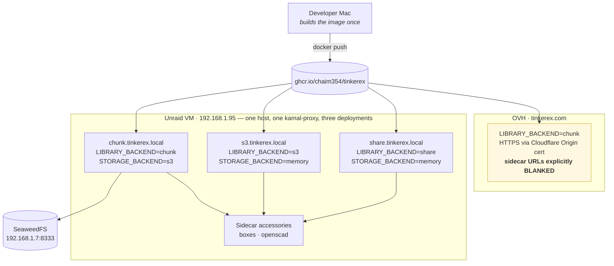

Two things here are non-obvious and are both guarded by `test/deploy_hygiene_test.rb`:

1. **Each destination must register a distinct hostname.** Three catch-all proxies on one host would
   collide and the last deploy would silently win.
2. **Kamal deep-merges `env.clear`,** so the OVH overlay inherits Unraid-only sidecar hostnames unless
   it *explicitly* blanks them. Inheriting one makes the addon report itself available and then fail
   every call — strictly worse than greying out. The test also pins `.to_s.blank?` rather than
   `.blank?`, because a YAML `false` becomes the literal string `"false"` in a Docker arg and reads
   as configured.

CI runs **exclusively on self-hosted runners** (`flasher-maker-linux`, `charless-MacBook-Pro-maker-mac`,
`CHAIMDESK-maker-windows`). GitHub bills only hosted runners, so no workflow may target `*-latest`.
Six workflows: `ci`, `rust-client`, `cross-os-e2e`, `nightly`, `build-app`, `install-app-on-runners`.

---

## 7. Recommended order of work

| # | Action | Effort | Why first |
|---|---|---|---|
| 1 | Add `image_thumb.rb:45` to `config/brakeman.ignore` (reuse the `mesh.rb` note) | minutes | Unblocks step 1 so step 2 can even run |
| 2 | `bundle update nokogiri loofah rails-html-sanitizer crass websocket-driver`, run the suite | ~1 h | Clears all 7 advisories including the High one on the always-on `/cable` path |
| 3 | Verify both gates by **exit code**, not by reading output | minutes | The failure mode being fixed is precisely a gate that looks like it passed |
| 4 | Decide the Active Storage direct-upload question (§2.3) | ~half day | The only unauthenticated write primitive in the app |
| 5 | Add a byte-length validation to `maker_sheets.data` | ~1 h | Unbounded user input with a render-time multiplier |
| 6 | `COPY LICENSE ./` in `sidecar/boxes/Dockerfile` | minutes | Closes the last GPL redistribution gap |
| 7 | One system test that types a formula, asserts the value, reloads, asserts the raw formula persists | ~half day | The suite has **zero** JS coverage; this shape of bug has already shipped twice |
| 8 | Either install F3D in the Dockerfile or annotate the registry entries | ~1 h | The CAD formats closest to the audience silently have no preview |
| 9 | Delete the stale "53 tests" count from `CLAUDE.md` §11 | minutes | It is 192; the file defers counts to `STATUS.md` elsewhere anyway |

---

## 8. Appendix — how every claim here was verified

```bash
# Test health
bin/rails test                                        # 1587 runs / 0 failures / 0 errors / 14 skips
(cd client/fs-provider && cargo test --quiet)         # 192 passed across 20 binaries
for c in sync-client sync-engine fs-cfapi fs-webdav fs-fskit stl-thumbnailer; do
  (cd client/$c && cargo test --quiet); done

# Security — check EXIT CODES, not output
bin/brakeman --no-pager; echo "brakeman=$?"           # 3  → job fails here
bin/bundler-audit;        echo "audit=$?"             # 1  → never reached in CI
bundle exec bundler-audit check --update              # the 7 advisories
bin/importmap audit                                   # 0  → green

# Architectural tripwires (from CLAUDE.md §12 step 10 and Phase 4)
grep -rn "manifest_chunks\|ChunkStore" app/services/maker/ app/models/maker/ app/jobs/maker/ \
  | grep -v ':[0-9]*: *#'                             # exactly 1: library_output.rb:47
grep -rn "rescue.*NotImplementedError" app lib | grep -v ':[0-9]*: *#'   # nothing
grep -rn "port_writable?" app/ | grep -v capabilities.rb                 # 5 doors + UI selects

# Auth surface
bin/rails routes | grep direct_upload                 # unauthenticated POST route is live
for f in $(find app/controllers -name '*_controller.rb' -not -path '*/v1/*' -not -path '*/users/*'); do
  grep -q 'authenticate_user!' $f || echo "$f"; done   # 6 hits, all explained in §2.3

# Licensing
grep -n 'COPY' sidecar/boxes/Dockerfile               # no LICENSE
grep -n 'COPY' sidecar/openscad/Dockerfile            # COPY LICENSE README.md ./
grep -n 'f3d' Dockerfile                              # nothing — §2.6
```

---

*Audit performed 2026-07-28 against commit `6ca3dd7`. Every finding above was produced by running the
command shown, not by reading documentation — including the findings that agree with the
documentation.*
